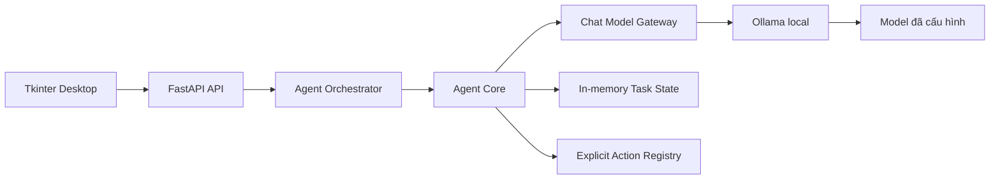

# NEUTRONS

NEUTRONS là trợ lý AI cá nhân theo hướng local-first. Phiên bản hiện tại gồm giao
diện desktop Tkinter, API FastAPI, Agent Core bounded và gateway kết nối duy nhất
đến model Ollama đã cấu hình. Backend chỉ bind vào `127.0.0.1`.

## Kiến trúc hiện tại



- `neutrons/desktop.py`: cửa sổ chat; gọi HTTP ở worker thread và cập nhật
  widget qua queue trên main thread.
- `neutrons/app.py`: request validation, giới hạn kích thước, API errors và
  request lifecycle logs; `/healthz` kiểm tra liveness, `/readyz` kiểm tra
  Ollama và model đã cấu hình.
- `neutrons/orchestrator.py`: xác thực tin nhắn, giới hạn lịch sử hội thoại,
  tích hợp Agent Core và giữ chat API tương thích.
- `neutrons/agent/`: schemas, intent router, planner, executor, result validator,
  state manager và luồng phối hợp task.
- `neutrons/model_gateway.py`: interface chat cùng adapter Ollama, kiểm tra
  response, model availability và model metadata.
- `neutrons/config.py`: settings từ environment, kiểm tra giá trị và defaults.
- `neutrons/logging_config.py`: JSON logs, không ghi nội dung hội thoại.

### Agent Core (Phase 2)

Luồng task: request → Router → Planner → Executor → Result Validator → cập nhật
Task State. Router chỉ phân loại; Planner chỉ tạo plan; chỉ Executor được gọi
action đã đăng ký. Schemas Pydantic từ chối field không biết. Plan được giới hạn
tối đa 8 bước và 20.000 ký tự, kiểm tra action, ID duy nhất, dependency hợp lệ
và chu trình. Executor kiểm tra input/output schema, giới hạn output 20.000 ký
tự, permission, timeout (tối đa 30 giây), dependency và xác nhận riêng cho action
yêu cầu confirmation. Handler phải async và kiểm tra deadline/cancellation tại
các ranh giới an toàn. Permission mặc định là **deny**; model không thể tự cấp
quyền. Không có shell/Python execution.

Hiện chưa đăng ký action nào, do đó yêu cầu TASK được trả về trạng thái
`unsupported` một cách an toàn thay vì tạo tool giả. Muốn bật một action sau này,
ứng dụng phải đăng ký handler async cùng input/output schema và cấp policy quyền
riêng; destructive/consequential actions vẫn cần xác nhận rõ ràng. Chat thường
giữ nguyên API và fallback về chat cũ khi structured intent response không hợp lệ.

Task state được giữ trong bộ nhớ của process, tối đa 100 record; record terminal
cũ nhất có thể bị loại bỏ để nhường chỗ. State machine từ chối chuyển trạng thái
không hợp lệ; hủy chỉ được xử lý tại ranh giới an toàn giữa các bước. Đây chưa
phải API hủy tác vụ hay persistent task storage. Không có SQLite, memory bền vững,
hoặc UI task-management trong phase này.

## Cài đặt

Yêu cầu: Python 3.10 trở lên, môi trường ảo của dự án, Ollama đang chạy và model
đã được cài đặt sẵn. NEUTRONS không tự tải model hay thay đổi thư mục model Ollama.

Trong **PowerShell**, từ thư mục dự án:

```powershell
.\.venv\Scripts\python.exe -m pip install -r requirements.txt
ollama list
Invoke-RestMethod http://127.0.0.1:11434/api/tags
```

Nếu chưa có `.venv`, tạo một lần bằng:

```powershell
python -m venv .venv
.\.venv\Scripts\python.exe -m pip install -r requirements.txt
```

## Cấu hình

Các biến môi trường tùy chọn:

| Biến | Mặc định | Ý nghĩa |
|---|---:|---|
| `NEUTRONS_MODEL` | `qwen3:4b` | Tên model có sẵn trong Ollama |
| `OLLAMA_BASE_URL` | `http://127.0.0.1:11434` | Địa chỉ Ollama (HTTP/HTTPS, không chứa credentials) |
| `NEUTRONS_REQUEST_TIMEOUT` | `120` | Timeout request model, tính bằng giây |
| `NEUTRONS_READINESS_TIMEOUT` | `3` | Timeout readiness check, tối đa 30 giây |
| `NEUTRONS_TEMPERATURE` | `0.2` | Generation temperature (0–2) |
| `NEUTRONS_NUM_PREDICT` | `512` | Số token sinh tối đa |
| `NEUTRONS_NUM_CTX` | `4096` | Context window gửi cho Ollama |
| `NEUTRONS_API_PORT` | `8000` | Port API desktop sử dụng |
| `NEUTRONS_MAX_HISTORY_MESSAGES` | `40` | Số tin nhắn history tối đa |
| `NEUTRONS_MAX_HISTORY_CHARS` | `12000` | Giới hạn ký tự history gửi đến model |
| `NEUTRONS_MAX_REQUEST_CHARS` | `50000` | Giới hạn tổng ký tự trong request chat |
| `NEUTRONS_LOG_LEVEL` | `INFO` | `DEBUG`, `INFO`, `WARNING`, `ERROR` hoặc `CRITICAL` |

PowerShell đặt biến cho cửa sổ hiện tại bằng `$env:NEUTRONS_NUM_PREDICT = "256"`.
Trong **CMD**, cú pháp tương đương là `set NEUTRONS_NUM_PREDICT=256`.
Thay đổi environment rồi khởi động lại ứng dụng để settings được nạp lại.

Settings sai định dạng hoặc ngoài giới hạn sẽ báo lỗi khi ứng dụng khởi động.
History được chọn từ tin mới nhất về cũ hơn, không vượt giới hạn số tin và ký
tự. Tin nhắn mới nhất quá dài được giữ phần cuối; tin cũ chỉ được thêm nếu vừa
trọn vẹn vào phần ngân sách còn lại. Đây là giới hạn ký tự, chưa phải bộ đếm
token chính xác.

## Chạy giao diện desktop trên Windows

Nhấp đúp `start_neutrons.bat`, hoặc chạy trong PowerShell:

```powershell
.\.venv\Scripts\python.exe -m neutrons.desktop
```

Desktop kiểm tra backend tại `127.0.0.1:<NEUTRONS_API_PORT>`. Nếu chưa có backend,
nó tự khởi động một tiến trình local và giữ log để báo lỗi nếu khởi động thất
bại. Nếu port đã có ứng dụng khác, giao diện báo port conflict thay vì im lặng
khởi một server thứ hai.

Backend liveness và model readiness được kiểm tra riêng. Nếu API còn sống nhưng
Ollama/model chưa sẵn sàng, UI vẫn mở và hiển thị trạng thái
`BACKEND OK · MODEL CHƯA SẴN SÀNG`; lỗi model không bị nhầm là lỗi chiếm port.

Khi đóng giao diện, tiến trình backend do chính giao diện khởi chạy sẽ được dừng.
Backend đã chạy sẵn sẽ không bị dừng. `Enter` gửi tin nhắn; `Shift+Enter` xuống
dòng. Câu trả lời trên máy chạy model bằng CPU có thể cần vài chục giây.

## Chạy API độc lập (PowerShell)

```powershell
.\.venv\Scripts\python.exe -m uvicorn neutrons.app:app --host 127.0.0.1 --port 8000
```

Nếu đã đặt `NEUTRONS_API_PORT` khác `8000`, thay port trong lệnh trên cho khớp.
Không chạy thêm `ollama serve` nếu Ollama đã lắng nghe port `11434`.

Kiểm tra tình trạng backend:

```powershell
Invoke-RestMethod http://127.0.0.1:8000/healthz
```

Swagger UI: `http://127.0.0.1:8000/docs`.

`GET /healthz` chỉ xác nhận FastAPI đang sống, không gọi Ollama. `GET /readyz`
dùng timeout ngắn để xác nhận Ollama phản hồi và model cấu hình đã được cài:
trả `200` khi sẵn sàng, `503` khi provider/model không khả dụng. Endpoint này
không chạy inference và không cài/tải model.

### Chat API

`POST /api/v1/chat`:

```json
{
  "message": "Xin chào NEUTRONS",
  "history": []
}
```

History tùy chọn chỉ nhận `user` và `assistant`. Lỗi request trả 4xx; timeout
model trả 504; Ollama/model không sẵn sàng trả 503; response model không hợp lệ
trả 502. Chi tiết nội bộ của provider không được trả cho client.

## Kiểm thử

Chạy toàn bộ test trong **PowerShell**:

```powershell
.\.venv\Scripts\python.exe -m pytest -q
```

Test gateway sử dụng HTTP mock; bộ test thông thường không cần Ollama đang chạy
và không tải model.

## Khắc phục sự cố

- **Port API đang được sử dụng:** đóng backend NEUTRONS cũ hoặc cấu hình
  `NEUTRONS_API_PORT` sang port khác; cập nhật port trong lệnh Uvicorn nếu chạy
  API độc lập.
- **Ollama không kết nối được:** kiểm tra `ollama list` và
  `Invoke-RestMethod http://127.0.0.1:11434/api/tags`.
- **Model không tìm thấy:** xác nhận `NEUTRONS_MODEL` trùng với tên trong
  `ollama list`; NEUTRONS không tự pull/download model.
- **Timeout khi chat:** kiểm tra Ollama có đang xử lý request khác không. Có thể
  tăng `NEUTRONS_REQUEST_TIMEOUT`; giảm `NEUTRONS_NUM_PREDICT` để giới hạn độ
  dài câu trả lời.
- **Backend desktop khởi động thất bại:** thông báo lỗi có chứa log startup của
  backend. Kiểm tra dependency bằng `pip install -r requirements.txt`.

## Giới hạn và lộ trình

NEUTRONS hiện dùng một model local, không có memory bền vững, session manager,
tool execution capability, streaming hoặc event bus. History do desktop gửi
trong từng request, chưa lưu xuống SQLite. Agent Core hiện chỉ cung cấp nền tảng
bounded; chưa có action được bật. SQLite conversation memory, các capability
read-only có quyền hạn và tích hợp session vào desktop thuộc phase sau.
